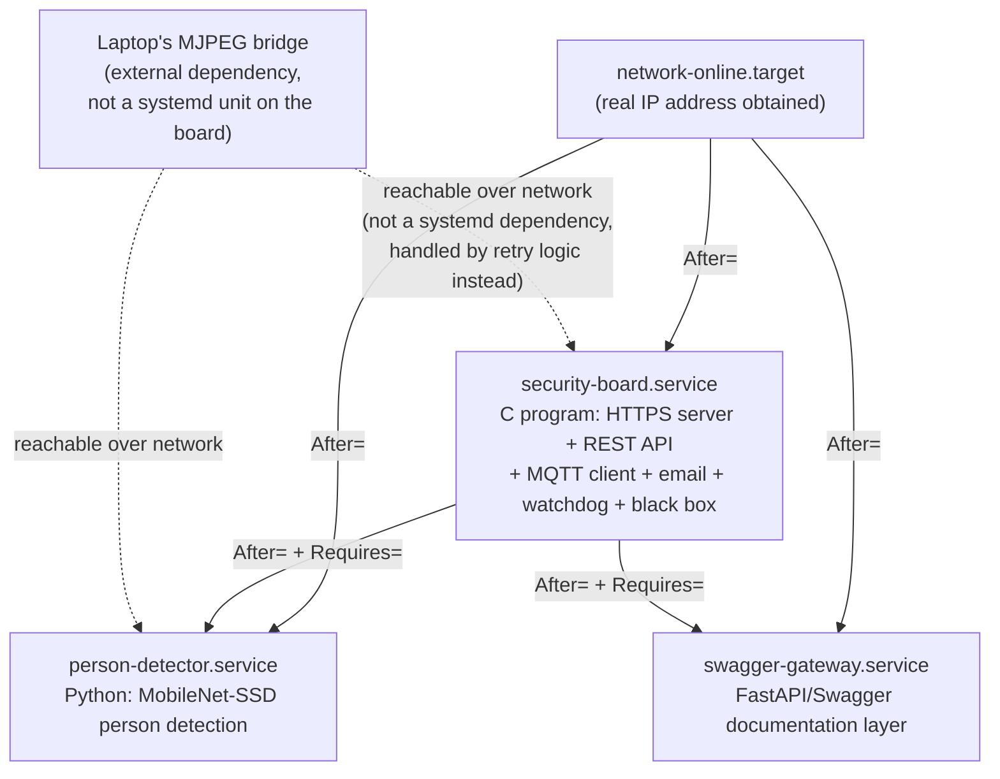

# Systemd Service Dependency Diagram (Part 1c)

## Diagram



## Explanation of the ordering choices

### Why `security-board.service` only needs `network-online.target`

The C board program is the foundation everything else sits on: it hosts the
HTTPS server, the REST API, the MQTT client, the email sender, the SQLite
black box, and the software watchdog. It needs a working network connection
(to reach the laptop's MJPEG stream, the MQTT broker, and an SMTP server),
but it does **not** need the Python detector or the Swagger gateway to
already be running — the dashboard and REST API should come up and be
reachable even if person-detection hasn't started counting people yet
(it'll just show 0 / stale data until the first detector update arrives).
This is why `security-board.service` only declares:

```ini
After=network-online.target
Wants=network-online.target
```

and nothing about the other two services.

### Why `person-detector.service` requires `security-board.service`

The Python detector's entire purpose is to POST its results to the board's
`/internal/detector-update` endpoint. A detector running with nowhere to
send its results to is useless for this project, so it declares a hard
dependency:

```ini
After=network-online.target security-board.service
Requires=security-board.service
```

`Requires=` (not just `Wants=`) means: if `security-board.service` fails or
is stopped, systemd will also stop `person-detector.service` rather than
leave it running uselessly in the background. `After=` on top of that
guarantees start-up ordering (Requires alone only implies a shutdown/failure
propagation relationship, not necessarily start ordering — you need both
directives together for a genuine "wait until X is up, then start me").

### Why `swagger-gateway.service` requires `security-board.service`

Identical reasoning: the FastAPI layer holds no logic of its own — every
route it exposes just forwards to the C server's REST API over loopback
HTTPS. Without the C server up, every single Swagger "try it out" call
would immediately fail with a connection error, so there's no reason for
this service to run without its dependency:

```ini
After=network-online.target security-board.service
Requires=security-board.service
```

### Why the laptop's camera bridge is *not* a systemd dependency

The spec's original wording ("image processing after the camera is ready")
assumes a locally-attached camera, where systemd could plausibly wait on a
udev device unit. Here the "camera" is a process on a **different physical
machine** reachable only over the network — systemd on the Orange Pi has no
way to express "wait until this HTTP endpoint on another host responds."

Instead, this dependency is handled at the application level:
`stream_proxy.c` (inside `security-board`) and `person_detector.py` both
retry their connection to the laptop's MJPEG URL in a loop with a short
backoff, logging a warning each time and recovering automatically the
moment the laptop bridge comes up — this was verified during development by
starting the board *before* the laptop bridge and confirming it correctly
logged `cannot connect ... retrying in 3s` and then picked up the stream
as soon as the laptop bridge was started. This is arguably more robust
than a hard systemd dependency would be anyway, since the laptop bridge can
legitimately be restarted independently at any time (e.g., the demo laptop
sleeps, the webcam gets unplugged and replugged) without needing to bounce
any service on the board.

### Boot-time sequence in practice

1. Board powers on, kernel + systemd start.
2. `network-online.target` is reached once the board has a real IP
   (measured in test 1-1 as part of total boot time).
3. `security-board.service` starts: initializes the black box (SQLite),
   starts the software watchdog thread, starts the MQTT client (connects to
   the broker, or retries if it's not up yet), starts the sensor-sampling
   thread, and starts the HTTPS + HTTP-redirect listeners.
4. The moment `security-board.service` reports as started (systemd
   considers a `Type=simple` service "started" as soon as the process is
   forked and exec'd, not once it's fully initialized — this is why the
   C program's own internal retry loops for the laptop stream and MQTT
   broker matter, rather than relying on ordering alone to guarantee those
   are ready).
5. `person-detector.service` and `swagger-gateway.service` start in
   parallel (systemd doesn't serialize sibling units unless you tell it
   to) — both depend only on `security-board.service`, not on each other.
